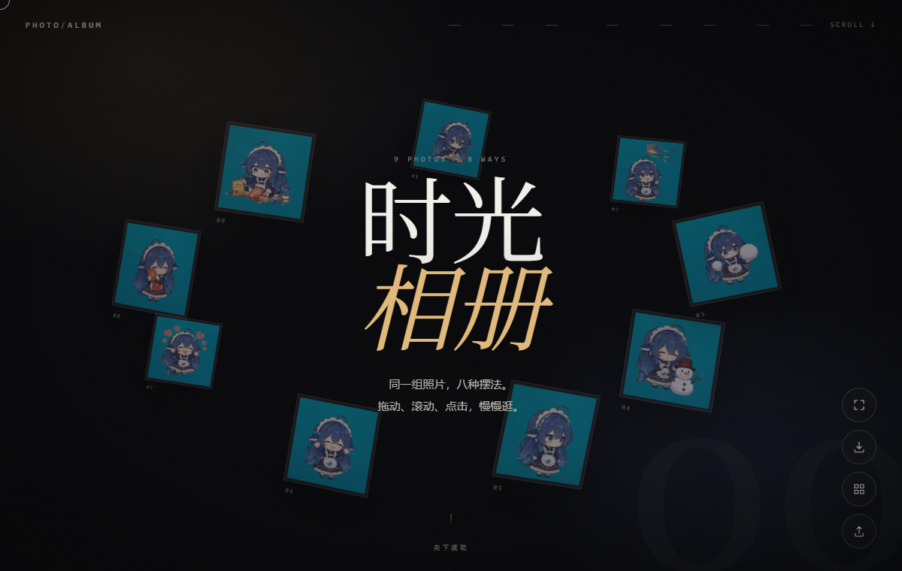
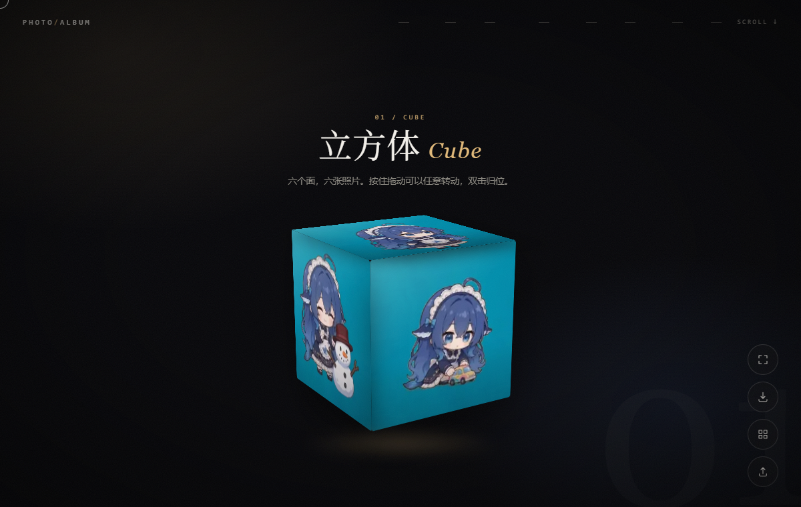
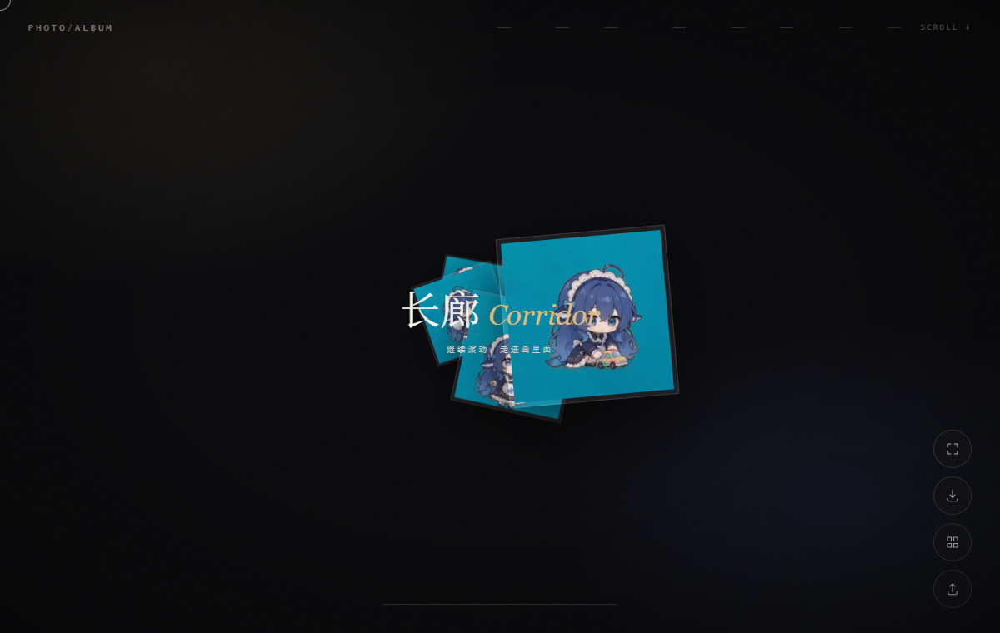
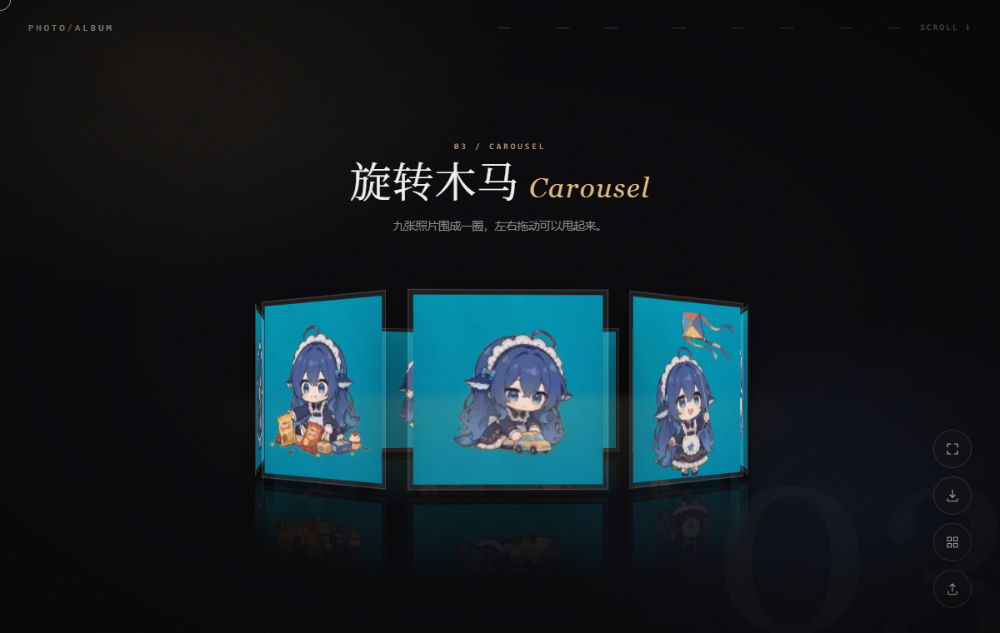
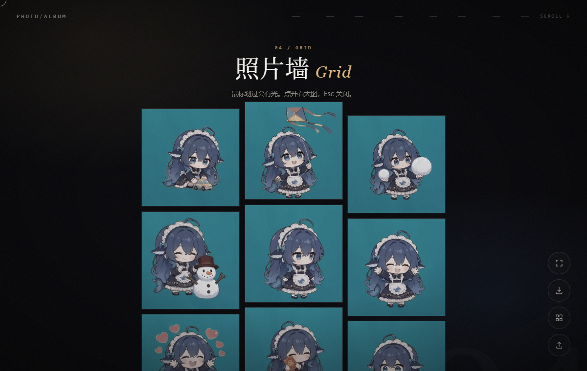
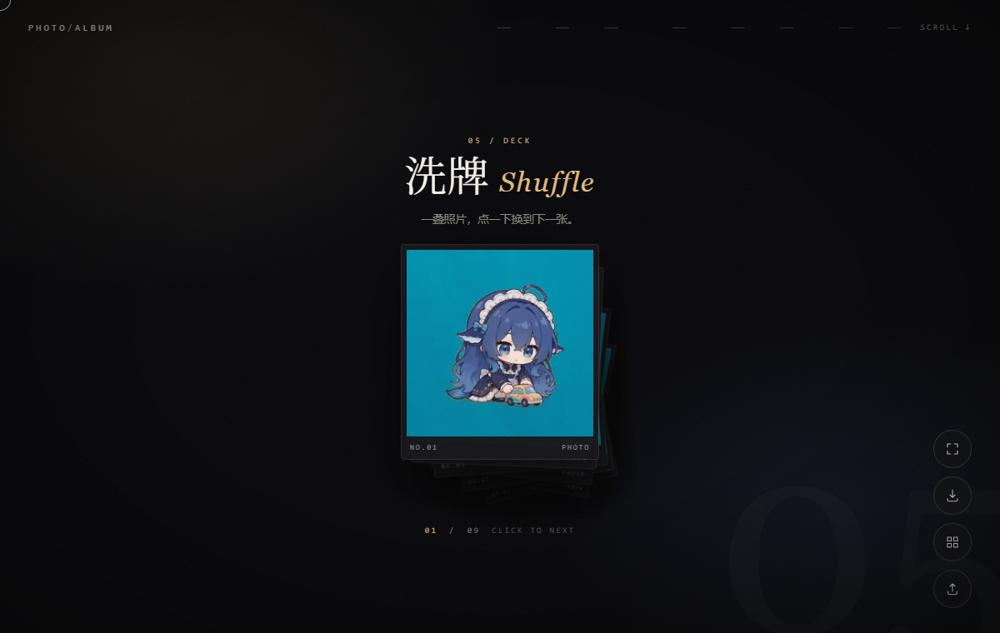
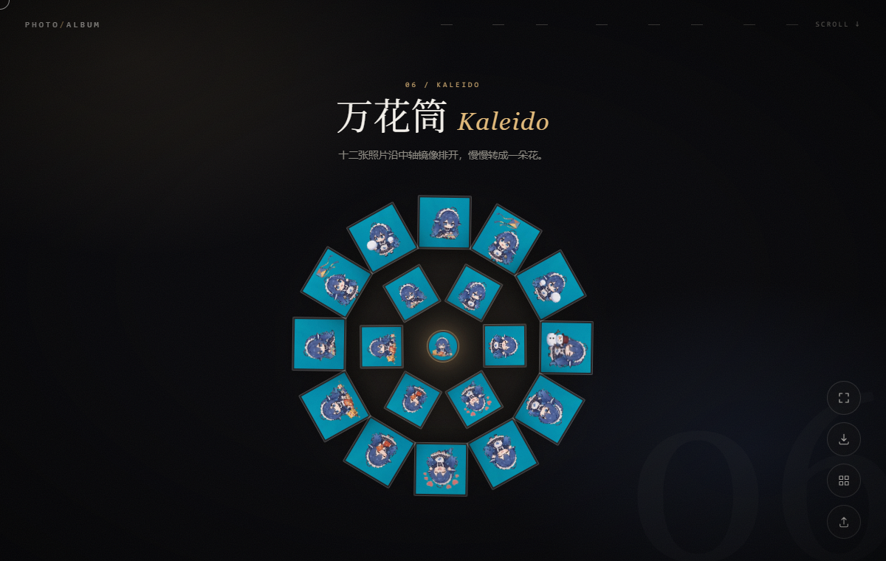
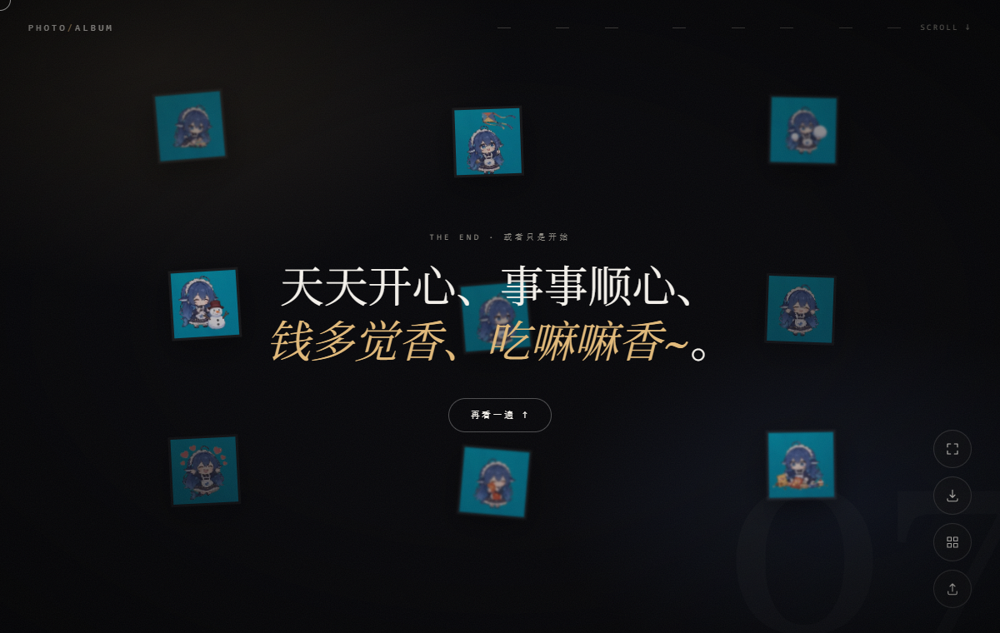
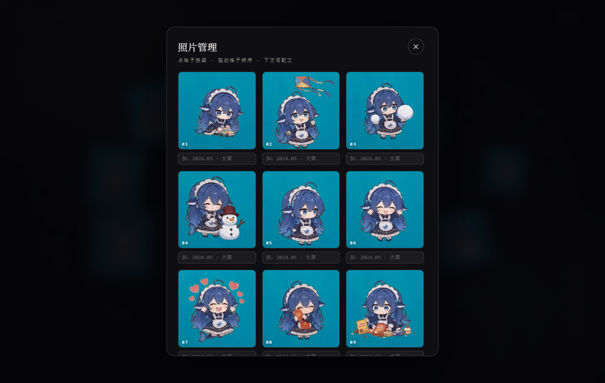

# 时光相册

> 九张照片，八种摆法。

一个纯前端的单文件相册页面。没有构建流程、没有依赖、没有后端——打开一个 HTML 就能跑。

**在线预览**：[xliky.github.io/photo-display-web](https://xliky.github.io/photo-display-web/)



---

## 八个场景

同一组照片，用八种完全不同的方式呈现。全部用 CSS 3D 变换和原生 JS 实现，没有引入 three.js 或任何动画库。

### 00 · 开场

照片以环形悬浮在文字周围，随鼠标移动产生视差。滚动往下开始。


### 01 · 立方体

六个面，六张照片。按住可以任意转动，松手有惯性，双击归位。



### 02 · 长廊

随滚动向纵深推进，照片从远处一张张迎面而来。这一段占三屏滚动距离，专门留出"走进去"的时间。



### 03 · 旋转木马

九张照片围成一圈。左右拖动可以甩起来，松手后带惯性旋转。



### 04 · 照片墙

九宫格布局。鼠标划过时整块跟着倾斜，并有一团光随光标移动。点击看大图。



### 05 · 洗牌

一叠照片，点一下最上面那张飞走，下一张浮上来。



### 06 · 万花筒

十二张照片沿中轴排成环形，奇偶交替做左右镜像——这是万花筒的成像原理。外圈与内圈反向旋转，可以按住拖动，转得越快中心光晕越亮。



### 07 · 尾声

照片散在四周缓慢浮动，点击任意位置会炸开一小簇照片。



---

## 照片管理

右下角的按钮打开管理面板。九宫格列出当前全部照片，每格底下带一个配文输入框。



| 操作 | 说明 |
|---|---|
| 点格子 | 替换这一张（也可批量替换） |
| 拖动格子 | 交换位置，鼠标直接拖，手机长按 0.4 秒后拖 |
| 左上角准星 | 进入构图模式，在格子上拖动调整裁剪焦点 |
| 输入框 | 写一句配文，灯箱打开时显示 |
| 金色圆点 | 标记这张已经换过 |
| 还原全部 | 回到最初那九张 |

拖拽时有一张半透明卡片跟着指针走；换图时新照片会从模糊虚影里慢慢显出颜色，像相纸在显影液里浮出来。

---

## 其他功能

**灯箱**：点开任意照片可放大，支持左右箭头、`←` `→` 方向键、手机左右滑翻页。打开时有 FLIP 飞入动画——从缩略图的位置放大展开。

**全屏**：隐藏浏览器界面，适合展示。

**导出独立网页**：把当前照片和配文打包成一个新的 HTML 下载。发给别人，对方双击就能看到你这一版，不再是原始那九张。

**九宫格长图**：一键生成 1080×1188 的 PNG，3×3 排版加落款日期，直接发朋友圈。

---

## 技术要点

**单文件、零依赖**
整个项目是一个 `index.html`，CSS、JS、照片（base64）全部内联。双击即可运行，断网也能用。

**3D 变换**
立方体、长廊、旋转木马、洗牌都是 `perspective` + `transform-style: preserve-3d` + `rotate3d` / `translateZ`，纯 CSS 实现，没有 WebGL。

**Pointer Events 统一输入**
鼠标和触摸走同一套逻辑：鼠标位移超过 10px 进入拖拽，手指需长按 380ms，避免与页面滚动抢手势。进入拖拽后拦截 `touchmove`，否则手指一移浏览器就当成翻页。

**双层存储**
照片同时写入 `localStorage`（快速读取）和 `IndexedDB`（容量大得多，突破 5MB 限制）。照片经 canvas 压缩到最长边 1280px、JPEG q0.8 再存，原图直存会把页面撑爆。

**导出实现**
克隆 `documentElement` → 清空运行时生成的 DOM → 在 `<head>` 注入 `window.__PHOTO_DATA__` → 序列化成 Blob 下载。页面脚本启动时优先读这个变量，所以导出的文件打开就是导出时的样子。

**性能取舍**
86 个图片节点同时做 `filter: blur()` 动画会直接卡死，所以显影动画只给视口 ±240px 内的图，其余直接换源。

---

## 本地打开

```
直接双击 index.html
```

不需要 `npm install`，不需要起服务。

---

## 兼容性

- Chrome / Edge / Safari 现代版本
- 移动端已适配：万花筒按屏幕宽度缩放、各场景压缩留白、横屏单独处理
- 尊重 `prefers-reduced-motion`，系统开启「减少动态效果」时会跳过大部分动画

---

## 关于照片

仓库里这九张是占位图。想换成自己的，打开页面 → 右下角按钮 → 拖入照片 → 写完配文 → 点「导出独立网页」。导出得到的文件才是属于你的版本。

直接改仓库里的 `index.html` 不会带上你上传的照片——那些只存在你自己浏览器里。
